<div align="center">

<a href="https://brian-dol.github.io/dev-quest/"></a>

# 🎮 Dev Quest

**A Mario-style platformer that walks you through the whole Software Development Lifecycle.**

[](https://github.com/Brian-Dol/dev-quest/actions/workflows/ci.yml)
[](https://github.com/Brian-Dol/dev-quest/actions/workflows/pages.yml)

### [▶ Play now](https://brian-dol.github.io/dev-quest/)

</div>

## The idea
Each of the 12 worlds is one phase of the SDLC. Run, jump, squash bugs 🐛, collect story-point coins 🪙 and hit `?` blocks 💡 to learn what happens in that phase. At the end of every world you get a summary of the deliverables, tools and risks.

| World | Phase | World | Phase |
|---|---|---|---|
| 1 | 🗣️ Requirements Gathering | 7 | 🧪 Testing |
| 2 | 🔍 Analysis & Feasibility | 8 | 🛡️ Security & Compliance |
| 3 | 🗺️ Planning | 9 | 🚀 Deployment & Release |
| 4 | 🏗️ Architecture & Design | 10 | 📡 Operations & Monitoring |
| 5 | 💻 Development | 11 | 🛠️ Maintenance & Support |
| 6 | 🔁 Code Review & CI | 12 | 🏁 Evolution & Retirement |

## Controls
| Action | Keyboard | Touch |
|---|---|---|
| Move | ← → or A D | on-screen ◀ ▶ |
| Jump | ↑, W or Space | JUMP |
| Confirm | Enter | OK / tap the screen |
| Pause / Mute | Esc / M | ⏸ / 🔊 buttons |

## Run locally
```bash
git clone https://github.com/Brian-Dol/dev-quest.git
cd dev-quest
npm start        # http://localhost:8080 (no dependencies to install)
npm test         # unit tests
npm run lint     # syntax check
```

## This project is itself an SDLC case study
| Phase | Artifact |
|---|---|
| Requirements | [docs/01-requirements.md](docs/01-requirements.md) |
| Analysis & feasibility | [docs/02-analysis.md](docs/02-analysis.md) |
| Planning | [docs/03-planning.md](docs/03-planning.md) |
| Architecture & design | [docs/04-architecture.md](docs/04-architecture.md) |
| Development & testing | [docs/05-development-and-testing.md](docs/05-development-and-testing.md), [`test/`](test) |
| CI/CD & deployment | [docs/06-deployment.md](docs/06-deployment.md), [`.github/workflows`](.github/workflows) |
| Operations, maintenance, evolution | [docs/07-operations-and-maintenance.md](docs/07-operations-and-maintenance.md) |

## Tech
Vanilla JavaScript (ES modules), HTML5 Canvas, Web Audio, GitHub Actions, GitHub Pages. Zero runtime dependencies. All art and names are original.

## License
MIT
