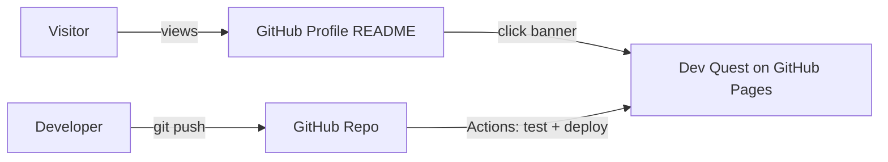
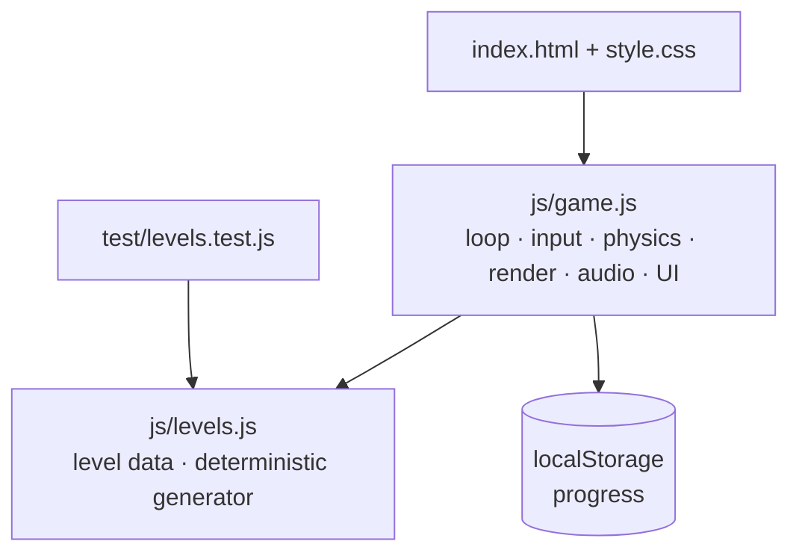

# 04 · Architecture & Design

## System context (C4 level 1)

## Containers / modules (C4 level 2)

## Design decisions
| # | Decision | Why |
|---|---|---|
| ADR-1 | Vanilla JS, ES modules, no build | Zero dependencies, trivial to host and audit |
| ADR-2 | Procedural levels from a seeded RNG | Content stays small and testable; reproducible |
| ADR-3 | Level logic separate from rendering | `levels.js` is pure so Node tests can run it |
| ADR-4 | Fixed 60 Hz timestep | Same physics on any monitor refresh rate |
| ADR-5 | Animated SVG banner for the profile | README can't run JS; SVG animates inside `` |
| ADR-6 | Progress in `localStorage` | No backend, no accounts, privacy friendly |

## Game design
- **Core loop:** run → jump → collect → learn → finish → review summary.
- **Metaphor mapping:** bugs = defects, coins = story points, `?` blocks = knowledge, spikes = hazards, flag = release.
- **Difficulty curve:** gaps and enemy density grow with the world number.
- **Controls:** keyboard (arrows/WASD/Space) and on-screen touch buttons.

## Data model
Tile map characters: `#` ground, `B` brick, `?` lesson, `c` coin, `^` spikes, `E` enemy, `P` start, `F` flag.
