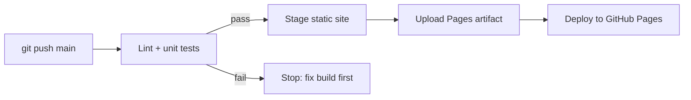

# 06 · Deployment & Release

## Pipeline

Defined in [`.github/workflows/pages.yml`](../.github/workflows/pages.yml). Pull requests and pushes also run [`ci.yml`](../.github/workflows/ci.yml).

## Environments
| Env | URL | Purpose |
|---|---|---|
| Local | `npm start` → http://localhost:8080 | Development |
| Production | https://brian-dol.github.io/dev-quest/ | Public game |

## Release & rollback
- **Release:** merge to `main`; the pipeline deploys automatically (typically < 2 min).
- **Rollback:** `git revert <commit>` and push, or re-run an earlier successful workflow run.
- **Versioning:** semantic version tags (`v1.0.0`) with GitHub Releases for notable changes.

## Profile integration
The profile README embeds `assets/banner.svg` (animated) inside a link to the Pages URL. README files cannot execute JavaScript, so the banner is the "teaser" and the click opens the playable game.
